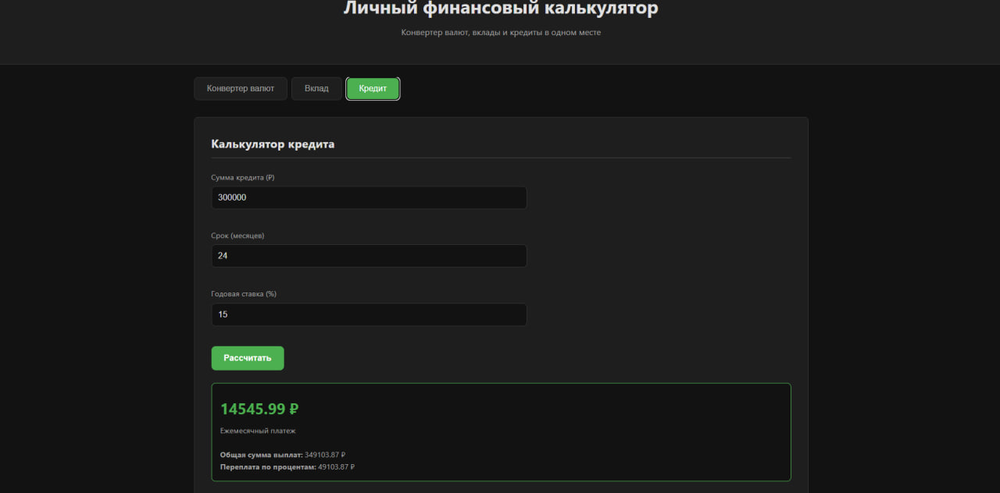

# Личный финансовый калькулятор

Проект выполнен в рамках итоговой работы по веб-технологиям.

Веб-приложение для конвертации валют по актуальному курсу, а также для расчета доходности банковских вкладов (с капитализацией и без) и аннуитетных платежей по кредитам.

[Демо](https://puk1sh2.github.io/finance-calculator/) · [GitHub](https://puk1sh2.github.io/finance-calculator/)

## Возможности
- **Конвертер валют:** конвертация более 30 мировых валют, просмотр истории курса за последние 5 дней.
- **Калькулятор вклада:** расчет итоговой суммы и прибыли с учетом ежемесячной капитализации или простого процента.
- **Калькулятор кредита:** расчет ежемесячного платежа, переплаты и общей суммы выплат по аннуитетной схеме.
- Валидация введенных данных (проверка на пустые поля и отрицательные числа).
- Обработка состояний загрузки и ошибок сети.
- Адаптивный дизайн (от 360 до 1440 px) и тёмная тема.
- Простой и понятный интерфейс на русском языке.

## Технологии
- **HTML5 / CSS3** — семантическая верстка, CSS Grid/Flexbox, CSS-переменные для тем.
- **JavaScript (ES6+)** — чистый JS без фреймворков, асинхронные запросы (`fetch`, `async/await`).
- **Frankfurter API** — публичный API для получения актуальных курсов валют и исторических данных (не требует ключа).

## Архитектура
Проект разделен на логические файлы:
- `index.html` — разметка страницы.
- `css/style.css` — стили и адаптивность.
- `js/main.js` — вся бизнес-логика приложения (вкладки, валидация, API-запросы и расчеты).

## Запуск локально
1. Клонировать репозиторий: `git clone ССЫЛКА`
2. Перейти в папку проекта.
3. Открыть `index.html` в браузере (или запустить через локальный сервер).

## Тесты
Тестирование проводилось вручную (проверка всех сценариев ввода и вывода данных).
На данный момент покрытие тестами не настроено (для варианта ★ не обязательно по ТЗ), но запланировано добавление Vitest для проверки математических формул.

## API
Приложение использует Frankfurter API (https://frankfurter.dev/). Ключи не требуются.

## Принятые решения
- **Чистый JavaScript:** выбран для варианта ★, чтобы показать понимание базовых принципов работы DOM, событий и асинхронности без использования фреймворков.
- **Frankfurter API:** выбран, так как он бесплатный, стабильный и не требует регистрации ключа, что упрощает развертывание.

## Безопасность
- Нет секретов в репозитории. Ключи не используются.
- Валидация пользовательского ввода на клиенте (защита от ввода некорректных данных).
- API-запросы выполняются по HTTPS.

## Использование ИИ-ассистентов
ИИ-ассистент использовался для генерации базового CSS-каркаса, написания формул сложного процента и аннуитета, а также для проверки синтаксиса JavaScript.

## Источники данных и лицензии
- Данные: [Frankfurter API](https://frankfurter.dev/)
- Лицензия проекта: MIT

## Что я бы улучшил
- Добавить графики курсов валют с помощью Chart.js (из усложнения варианта).
- Добавить возможность сохранения расчетов в localStorage.
- Настроить автоматическое тестирование (CI/CD).

## Автор
Студент: [Арсений Горбунов]